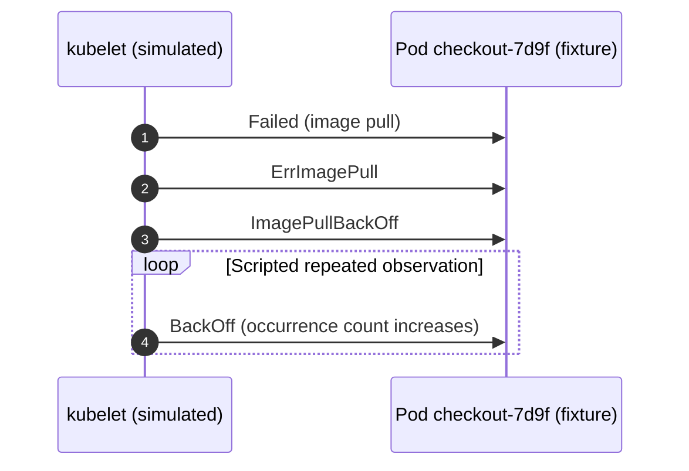
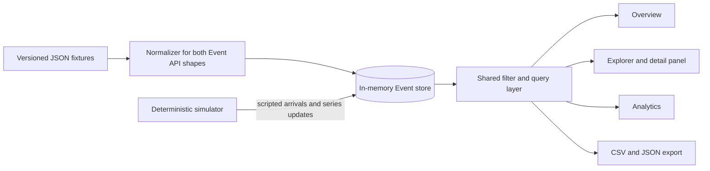

<div align="center">

<picture>
  <source media="(prefers-color-scheme: dark)" srcset="assets/logo-dark.svg">
  
</picture>

# Kubernetes Events Filter Dashboard

[](#roadmap)
[](#scope-and-non-goals)
[](#scope-and-non-goals)
[](https://github.com/lalit-contributes/k8s-events-filter-dashboard/actions)
[](https://github.com/lalit-contributes/k8s-events-filter-dashboard/actions)
[](https://react.dev)
[](https://www.typescriptlang.org)
[](LICENSE)

**A browser-based tool for inspecting, filtering and following a simulated stream of Kubernetes `Event` records.**

> **Simulated environment.** This dashboard reads synthetic fixtures and scripted local events only. It never contacts a Kubernetes cluster, reads `kubeconfig`, or requires cluster credentials. Every screen that presents Event data must clearly identify it as simulated.

<br>

[](docs/SPEC.md)
[](https://k8s-events-filter-dashboard-kappa.vercel.app/)


</div>

---

Finding the few Warnings relevant to a workload inside routine `Scheduled`, `Pulling` and other Events is difficult in a flat list. This project explores whether combining filters, a persistent detail panel and summaries from one shared dataset can make Event inspection more direct. It does not attempt to diagnose failures or imply that an Event proves why a workload failed.

<details>
<summary><b>Contents</b> (click to expand)</summary>

- [Features](#features)
- [Try the demo walkthrough](#try-the-demo-walkthrough)
- [Screens](#screens)
- [Simulator scenarios](#simulator-scenarios)
- [Filter rules](#filter-rules)
- [Quick start](#quick-start)
- [Architecture](#architecture)
- [Event API mapping](#event-api-mapping)
- [Scope and non-goals](#scope-and-non-goals)
- [Roadmap](#roadmap)
- [Contributing](#contributing)
- [Stats](#stats)
- [References](#references)

</details>

---

## Features

| Capability | What it provides |
|---|---|
| **Combined filters** | Namespace, Event type, reason, referenced object kind/name, reporter and time range; filter categories combine with AND and selected values within a category combine with OR. |
| **Keyword search** | Case-insensitive search across reason, message, referenced object name, Event namespace and reporter. |
| **Event detail panel** | Opens beside the explorer so the table, filters and scroll position can be retained while inspecting records. |
| **Raw JSON view** | The original source record for review, including fields not surfaced by the UI. Normalization must not mutate this record. |
| **Overview and analytics** | Counts, time buckets and breakdowns derived from the same normalized data and active query as the explorer. |
| **Deterministic simulator** | Five scripted scenarios with play, pause, speed and reset controls. Scenarios are not random. |
| **CSV and JSON export** | Exports the complete filtered result set across all pages; JSON preserves source-record shapes. CSV escaping and spreadsheet formula-injection protections are tested. |
| **Simulated-data label** | A persistent, visible label on every screen that presents Event data, including record details. |
| **Accessible interactions** | Keyboard-operable controls, visible focus, non-colour status cues and accessible alternatives to chart-only information. |

These are the product requirements and intended behavior. The [roadmap](#roadmap) tracks implementation progress; a requirement should not be treated as implemented merely because it is documented here.

---

## Try the demo walkthrough

<details>
<summary><b>Start the 7-step review demo</b></summary>

1. Start the app and load the **Normal rollout** scenario.
2. Switch the scenario to **Image pull failure**.
3. Filter **Type = Warning** and **Namespace = payments**.
4. Search for the affected Pod name.
5. Open its **BackOff** record in the detail panel.
6. Check the first- and last-observed timestamps, occurrence-count status and raw JSON.
7. Visit **Analytics** to inspect the warning distribution, then export the filtered result as CSV or JSON.

</details>

---

## Screens

<details>
<summary><b>Overview</b></summary>

- Summary metrics: Event records in range, Warnings, Normals and represented namespaces.
- Event volume grouped into consistent time buckets.
- A ranking of common reasons.
- A recent-Warnings list. Selecting a record opens the detail panel.
- All values reflect the shared active time range and query semantics.

Invalid timestamps are not silently assigned to a time bucket. Any excluded records must be accounted for in an accessible chart description so the chart does not imply complete temporal coverage.

</details>

<details>
<summary><b>Event explorer</b></summary>

- Primary controls for keyword search, time range, namespace and Event type.
- Additional filters for reason, referenced resource kind, resource name and reporter.
- Removable chips for active filters, a visible clear action and a live result count.
- A fixed page size of 50 rows. A filter change resets pagination to page 1.
- Sorting by first-observed time, last-observed time, namespace, type, reason, object name and occurrence count. Sort ties remain deterministic and missing values sort last.
- A detail panel that preserves the explorer context and returns keyboard focus to the originating row when it is still available.

Press <kbd>/</kbd> to focus search and <kbd>Esc</kbd> to close the detail panel when those shortcuts are available in the implementation. Keyboard access must not depend on these shortcuts.

</details>

<details>
<summary><b>Analytics</b></summary>

- Event records by time bucket.
- Warning vs Normal distribution.
- Top reasons and namespace counts.
- **Charts are controls.** Selecting a segment or reason applies the equivalent filter and opens the explorer with the shared query state.
- Chart labels identify the active interval and whether a value counts **Event objects** or **recorded occurrences**. The text/table alternative exposes the same data to keyboard and assistive-technology users.

A series of 50 occurrences is one Event record; its occurrence count is not the number of distinct Event objects.

</details>

---

## Simulator scenarios

Scenarios are **scripted, not random**, so the same fixture and sequence reproduce the same review state. Simulated arrivals join the same in-memory store as the initially loaded fixtures.

| Scenario | Sequence | What it demonstrates |
|---|---|---|
| Normal rollout | `Scheduled` → `Pulling` → `Pulled` → `Created` → `Started` → `SuccessfulCreate` | Normal flow across Deployment, ReplicaSet and Pods |
| Image pull failure | `Failed` → `ErrImagePull` → `ImagePullBackOff` → `BackOff` | Warnings repeated against one workload |
| Scheduling pressure | `FailedScheduling` → later `Scheduled` | Time ordering and a change in a Pod's scheduling state |
| Container health | `Unhealthy` → `BackOff` → `Killing` → `Started` | Repeated observations and occurrence counts |
| Node condition | `NodeNotReady` or node pressure → recovery | Cluster-scoped Event records and resource-kind filtering |

<details>
<summary><b>Preview the image pull failure sequence</b></summary>



Repeated `BackOff` observations in one Event series update that record's occurrence count and last-observed time while preserving its logical ID. They must not create a new table row for every occurrence. This sequence is an illustrative simulation, not a live kubelet interaction.

</details>

Simulator controls live in the shared header: scenario selector, play/pause, speed and reset. Reset requires a visible confirmation. Speed changes the delay between scripted arrivals; it never changes the Event timestamps or order. The proposed speed options are 0.5x, 1x, 2x and 4x, with 1x as the default.

The in-memory record cap is defined once as `MAX_IN_MEMORY_EVENTS` (default 10,000). At the cap, the simulator pauses visibly rather than silently dropping records. Reset restores the scenario's initial fixture and removes generated arrivals.

---

## Filter rules

| Filter | Match rule |
|---|---|
| Namespace | Exact match against Event metadata namespace; multiple selected values use OR. |
| Type | Exact `Normal` / `Warning` match. Selecting both means no type restriction. |
| Reason | Exact reason values; multiple selected values use OR. |
| Resource kind | Exact match against the referenced object's `kind`. |
| Resource name | Case-insensitive substring of the referenced object's name. |
| Reporter | Exact match against the normalized reporting controller/component value. |
| Time range | Effective last-observed time must fall in the selected range. Bounded ranges exclude missing or invalid effective timestamps. |
| Keyword | Case-insensitive search across reason, message, referenced object name, Event namespace and reporter. |

**Combination logic:** filter categories combine with **AND**. Multiple selected values within one category combine with **OR**.

> Example: `Namespace = payments AND Type = Warning AND (Reason = BackOff OR Reason = Failed) AND last observed within 1 hour`

The initial and clear-all time range is **All available**. Relative presets are 15 minutes, 1 hour, 6 hours and 24 hours, with custom start/end ranges also supported. Relative ranges are anchored to the deterministic simulator clock, not to the machine's current time. The custom range uses UTC internally and displays the local timezone; its start and end are inclusive.

The default order is newest effective last-observed time first. Missing values sort last, and ties are stable. Filtering, result counts, overview metrics, analytics and exports all use the same query semantics. Changing a filter resets the explorer to page 1; clear-all restores All available, newest-first sorting and page 1.

---

## Quick start

<details>
<summary><b>Requirements</b></summary>

- Node.js **24 LTS** (the `.nvmrc` file contains `24`).
- npm supplied with the selected Node.js 24 installation; use the version recorded by the project toolchain.
- A modern browser (Chrome, Firefox, Safari or Edge). Chromium is installed for Playwright browser tests.
- A clean checkout with the committed `package-lock.json`.

The app itself is static and local. Normal use does not require a backend, database, account, cluster credentials, environment secrets or runtime API endpoint.

</details>

<details>
<summary><b>Choose your platform</b></summary>

<details>
<summary>Linux or macOS</summary>

```bash
git clone https://github.com/lalit-contributes/k8s-events-filter-dashboard.git
cd k8s-events-filter-dashboard
nvm install 24       # if using nvm and Node 24 is not installed
nvm use              # reads .nvmrc
npm ci               # reproducible install from package-lock.json
npm run dev          # open http://127.0.0.1:5173/
```

</details>

<details>
<summary>Windows (PowerShell)</summary>

Install Node.js 24 LTS, then run:

```powershell
git clone https://github.com/lalit-contributes/k8s-events-filter-dashboard.git
cd k8s-events-filter-dashboard
node --version       # confirm Node.js 24.x
npm ci               # reproducible install from package-lock.json
npm run dev          # open http://127.0.0.1:5173/
```

</details>

<details>
<summary>No install: open in the browser</summary>

Use **Open in GitHub.dev** to browse or edit repository files in the browser-based editor. GitHub.dev itself is not a running development environment, so it does not provide the local Vite server. To run the app in a hosted workspace, use **Open in Gitpod** when a compatible workspace is available, then install dependencies with `npm ci` and run `npm run dev` in its terminal.

</details>

</details>

<details>
<summary><b>Run the tests</b></summary>

```bash
npm run lint              # ESLint, with zero warnings allowed
npm run typecheck         # strict TypeScript check
npm run validate:fixtures # source fixture and scenario validation
npm run test              # unit tests
npm run test:coverage     # unit tests plus enforced layer coverage thresholds
npx playwright install chromium
npm run test:e2e          # browser acceptance tests TC-01 to TC-10 and supplemental checks
npm run bench             # local 2,500-record performance benchmark
npm run check:bundle      # enforce initial JavaScript gzip budget
npm run verify            # run all required local verification gates
```

The coverage report is written locally to `coverage/`. CI retains coverage, browser-test and benchmark reports as workflow artifacts; coverage is not uploaded to Codecov by default and no Codecov token is required.

</details>

<details>
<summary><b>Build for production</b></summary>

```bash
npm run build       # typecheck and build for a root-hosted site; output in dist/
npm run preview     # preview at http://127.0.0.1:4173/
```

For the project's GitHub Pages path, build with:

```bash
npm run build:pages # output in dist/ with /k8s-events-filter-dashboard/ as base path
```

The normal build uses `/`; the Pages build uses `/k8s-events-filter-dashboard/`. Previewing the root build does not validate the Pages subpath. The deployment workflow must wait for successful CI on `main` before publishing to GitHub Pages.

</details>

---

## Architecture

The app runs entirely in the browser. There is no backend, database, authentication, production Event history or telemetry. The runtime must not load remote fonts, scripts, fixture data or other third-party resources. All event reads use local fixtures and in-memory state; browser downloads are used for local exports.



| Layer | Responsibility |
|---|---|
| Fixture repository | Versioned synthetic JSON with Normal and Warning Events, multiple namespaces, both API shapes and deterministic scenario steps. |
| Normalization | Maps version-specific fields to one typed record while preserving `rawEvent` unchanged. |
| Event store | Holds fixtures and scripted arrivals; the single in-memory source for every view. |
| Filter and query | Applies namespace, type, reason, resource, reporter, keyword, time and sorting rules consistently. |
| Simulation engine | Schedules deterministic arrivals and handles play, pause, speed, reset and the maximum-record limit. |
| Presentation | Renders overview, explorer, detail panel, charts, explicit empty/invalid states and export controls. |

The domain modules for normalization, timestamp handling, filtering, sorting, pagination, aggregation and export must be pure TypeScript and must not import React, Recharts or UI modules. Components call the shared query layer instead of implementing their own filters.

### Performance

The responsiveness target is **250 ms or less** for a namespace/type filter change, keyword search and bounded time-range change against the deterministic 2,500-record benchmark. The benchmark reports the median, minimum and maximum across 10 measured samples after warmup.

Measured on 14 November 2026 on macOS 27.0 (darwin arm64), Node.js v24.21.0: namespace/type filter **0.053 ms** median, keyword search **0.216 ms** median, and bounded 1-hour time filter **0.711 ms** median. These measurements cover pure domain operations, not browser rendering. Results are recorded in `bench/results.json`.

The build also enforces a hard limit of **500 KiB gzip** for the initial JavaScript dependency graph. This is checked by the project's manifest-based bundle-size script, not by Vite's default uncompressed chunk warning.

---

## Event API mapping

<details>
<summary><b>How the two Event API versions line up</b></summary>

| Normalized field | `events.k8s.io/v1` | `core/v1` (`apiVersion: v1`) |
|---|---|---|
| Object reference | `regarding` | `involvedObject` |
| Message | `note` | `message` |
| Reporter | `reportingController` | reporting fields, then `source.component` where present |
| First observed | `eventTime` | `eventTime`, then `firstTimestamp` |
| Last observed | `series.lastObservedTime` when present | `lastTimestamp` when present |
| Occurrences | `series.count` when present | `count` when present |
| Creation fallback | `metadata.creationTimestamp` | `metadata.creationTimestamp` |

**Timestamp and count rules**

- First-observed and effective last-observed timestamps are separate fields; do not collapse them into a single “timestamp”.
- Timestamps are normalized to UTC ISO strings when valid and displayed in local time with the timezone clearly shown.
- `metadata.creationTimestamp` is a last-resort fallback and must be marked as a fallback in the detail panel; it must not be presented as a precise occurrence time.
- If a selected higher-priority timestamp is present but invalid, mark it invalid rather than silently substituting the current time or hiding the invalid value behind a lower-priority candidate.
- Invalid or missing effective last-observed times remain inspectable in **All available**, but are excluded from bounded time filters and time-bucket aggregation. Charts must explain this exclusion where relevant.
- Missing values display as **Not supplied**. A missing occurrence count remains missing; it is not automatically changed to `1`. A malformed count is marked **Invalid value**.
- `rawEvent` retains the original source shape so the record can be inspected and exported without losing version-specific fields.

</details>

---

## Scope and non-goals

This project studies **Event inspection and filtering**. It deliberately does **not**:

- Connect to a real cluster, read `kubeconfig`, inspect cluster contexts or require Kubernetes credentials.
- Provide a backend, database, account system, authentication, persistent production history, alerts or notifications.
- Mutate Kubernetes resources, implement a Kubernetes API server, replace `kubectl`, collect metrics/logs or send telemetry.
- Diagnose failures or claim that an Event by itself proves why a workload failed.
- Send fixture data, search queries or export contents to external services.
- Persist scenario state in `localStorage` or `sessionStorage` by default. Reloading returns the app to the initial scenario unless persistence is separately specified and documented.

> Kubernetes documents Events as best-effort supplemental information with limited retention. This dashboard's time range describes its local sample dataset; the UI must never imply that Kubernetes Events provide a complete or permanent audit history.

---

## Roadmap

**Progress:** `▓▓▓▓▓▓▓▓▓░` 86% (6 of 7 milestones; implementation and acceptance checks updated 14 November 2026)

- [x] Requirements and product definition (PRD v1.0)
- [x] Fixture set and normalization for both Event API shapes
- [x] Event explorer: table, search, filters, sorting, pagination and detail panel
- [x] Simulator with five scenarios and play, pause, speed and reset
- [x] Overview and analytics, with charts that agree with the shared query results
- [x] CSV and JSON export, empty/invalid states and keyboard accessibility checks
- [ ] Upstream: discuss a `kubectl events` field-selector candidate with SIG CLI

<sub>The 2,500-record performance benchmark measures domain operations rather than browser rendering latency. The upstream item is a discussion candidate, not an accepted Kubernetes feature or a guaranteed pull request.</sub>

---

## Contributing

Contributions are welcome. Read [`AGENTS.md`](./AGENTS.md) for coding-agent constraints and [`docs/SPEC.md`](./docs/SPEC.md) for the product requirements. `BUILD_SPEC.md` defines the toolchain, verification gates and deployment rules. The product spec defines intended behavior; a documented requirement is not proof that it has already been implemented.

1. Fork the repo and create a branch: `git checkout -b feat/your-idea`.
2. Link the change to a relevant requirement (`FR-xx`) or acceptance test (`TC-xx`), and add/update tests.
3. Run `npm ci` and `npm run verify`; address failures before opening a pull request.
4. Review `git diff --check` and confirm the change does not introduce external runtime requests, persistence, a new dependency or a live-cluster integration.
5. Open a pull request that explains the behavior changed and the verification performed.

<details>
<summary><b>Good first issues</b></summary>

- [Good first issues](https://github.com/lalit-contributes/k8s-events-filter-dashboard/labels/good%20first%20issue) (view open items)

Typical starting points: add synthetic fixture coverage for an optional field, improve a keyboard interaction, add a filter/export unit test, or improve an accessible chart description.

</details>

<details>
<summary><b>Contributors</b></summary>

[](https://github.com/lalit-contributes/k8s-events-filter-dashboard/graphs/contributors)

</details>

---

## Stats

<div align="center">

[](https://star-history.com/#lalit-contributes/k8s-events-filter-dashboard&Date)

</div>

---

## References

1. [`kubectl events`](https://kubernetes.io/docs/reference/kubectl/generated/kubectl_events/): command reference.
2. [KEP-1440: `kubectl events`](https://github.com/kubernetes/enhancements): motivation and history; historical context is not evidence that every earlier request remains open.
3. [Field Selectors](https://kubernetes.io/docs/concepts/overview/working-with-objects/field-selectors/): supported Event fields.
4. [Event, `events.k8s.io/v1`](https://kubernetes.io/docs/reference/kubernetes-api/cluster-resources/event-v1/): API reference.
5. [Event, `core/v1`](https://kubernetes.io/docs/reference/kubernetes-api/cluster-resources/event-v1/): API reference.
6. Kubernetes issue #29838: historical sorting discussion, closed and linked to PR #99557.

---

## License

Licensed under the Apache License, Version 2.0. See [LICENSE](LICENSE) for the full text.

---

<div align="center">
<sub>Simulated data only. No cluster is contacted. Made for learning and review.</sub><br>
<sub>If this helped you understand Events, consider starring the repo.</sub>
</div>
