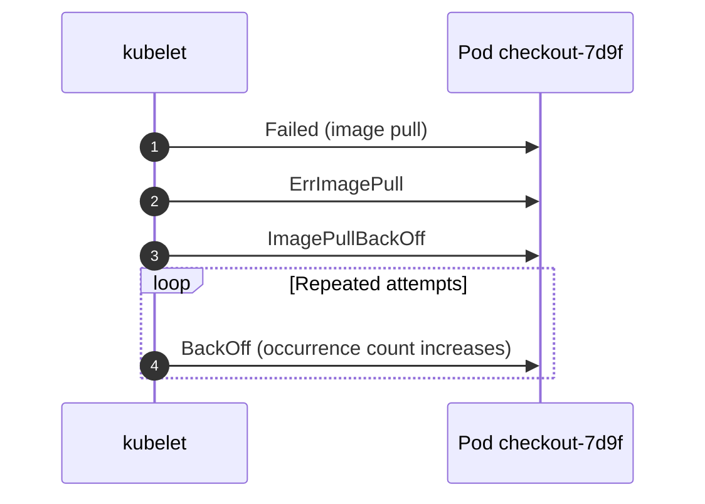
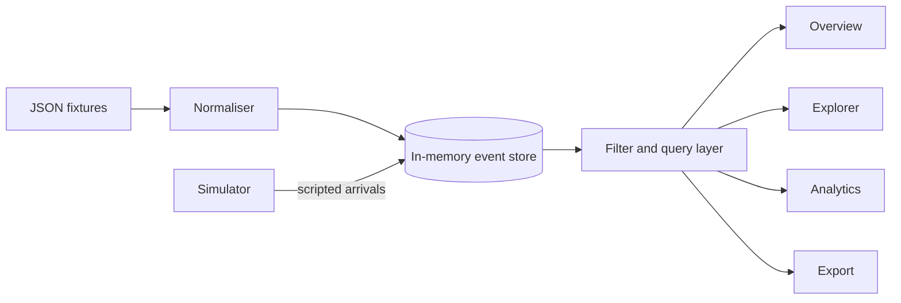

<div align="center">

<picture>
  <source media="(prefers-color-scheme: dark)" srcset="assets/logo-dark.svg">
  
</picture>

# Kubernetes Events Filter Dashboard

[](#roadmap)
[](#scope-and-non-goals)
[](#scope-and-non-goals)
[](https://github.com/lalit-contributes/k8s-events-filter-dashboard/actions)
[](https://codecov.io/gh/lalit-contributes/k8s-events-filter-dashboard)
[](https://react.dev)
[](https://www.typescriptlang.org)
[](LICENSE)

**A browser-based tool for inspecting, filtering and following a simulated stream of Kubernetes `Event` records.**

> **Simulated environment.** This dashboard never contacts a Kubernetes cluster. It reads synthetic fixtures and labels every screen as simulated.

<br>

[](https://lalit-contributes.github.io/k8s-events-filter-dashboard/)
[](docs/SPEC.md)
[](https://github.dev/lalit-contributes/k8s-events-filter-dashboard)
[](https://gitpod.io/#https://github.com/lalit-contributes/k8s-events-filter-dashboard)

</div>

---

Finding the three Warnings that explain an incident inside a stream of routine `Scheduled` and `Pulling` noise is the problem this dashboard solves.

<details>
<summary><b>Contents</b> (click to expand)</summary>

- [Features](#features)
- [Try the demo walkthrough](#try-the-demo-walkthrough)
- [Screens](#screens)
- [Simulator scenarios](#simulator-scenarios)
- [Filter rules](#filter-rules)
- [Quick start](#quick-start)
- [Architecture](#architecture)
- [Event API mapping](#event-api-mapping)
- [Scope and non-goals](#scope-and-non-goals)
- [Roadmap](#roadmap)
- [Contributing](#contributing)
- [Stats](#stats)
- [References](#references)

</details>

---

## Features

| Feature | What it gives you |
|---|---|
| **Combined filters** | Namespace, type, reason, kind, name, reporter and time range, all composable |
| **Keyword search** | Case-insensitive across reason, message, object name, namespace and reporter |
| **Detail panel** | Opens beside the table, so your filters and scroll position survive |
| **Raw JSON view** | The untouched source record, including fields the UI does not show |
| **Overview and analytics** | Counts and charts computed from the *same* filtered rows as the table |
| **Event simulator** | Scripted scenarios with play, pause, speed and reset |
| **CSV and JSON export** | Exports the full filtered result set, not just the visible page |
| **Always labelled** | Every screen shows that its data is simulated |

---

## Try the demo walkthrough

<details>
<summary><b>Start the 7-step review demo</b></summary>

1. Start the app and load the **Normal rollout** scenario.
2. Switch the scenario to **Image pull failure**.
3. Filter **Type = Warning** and **Namespace = payments**.
4. Search for the affected Pod name.
5. Open its **BackOff** record in the detail panel.
6. Check the **occurrence count** and the **raw JSON**.
7. Visit **Analytics** to see the warning distribution, then **Export** the filtered result.

</details>

---

## Screens

<details>
<summary><b>Overview</b></summary>

- Summary cards: records in range, Warnings, Normals, namespaces represented
- Event volume over time buckets
- Top reasons ranking
- Recent Warnings list. Click one to open its detail panel.

Every number responds to the active time range.

</details>

<details>
<summary><b>Event explorer</b></summary>

- Toolbar: search, time range, namespace, type
- Filter area: reason, resource kind, resource name, reporter
- Removable filter chips and a live result count
- 50 rows per page. Any filter change returns to page 1.
- Sort by first seen, last seen, namespace, type, reason, object or count

Press <kbd>/</kbd> to focus search and <kbd>Esc</kbd> to close the detail panel.

</details>

<details>
<summary><b>Analytics</b></summary>

- Event volume by time bucket
- Warning vs Normal distribution
- Top reasons and namespace counts
- **Charts are controls.** Clicking a segment applies the matching filter in the explorer.

Labels state whether a count refers to **Event objects** or **recorded occurrences**. A series of 50 occurrences is one Event record.

</details>

---

## Simulator scenarios

Scenarios are **scripted, not random**, so every review reproduces the same screen state.

| Scenario | Sequence | Teaches |
|---|---|---|
| Normal rollout | `Scheduled` → `Pulling` → `Pulled` → `Created` → `Started` → `SuccessfulCreate` | Normal flow across Deployment, ReplicaSet and Pods |
| Image pull failure | `Failed` → `ErrImagePull` → `ImagePullBackOff` → `BackOff` | Repeated Warnings against one workload |
| Scheduling pressure | `FailedScheduling` → later `Scheduled` | Time ordering and scheduling state change |
| Container health | `Unhealthy` → `BackOff` → `Killing` → `Started` | Repeated observations and occurrence counts |
| Node condition | `NodeNotReady` (or pressure) → recovery | Cluster-scoped records and filtering by kind |

<details>
<summary><b>Preview the image pull failure sequence</b></summary>



Repeated `BackOff` events stay **one record** with a rising count, not many separate failures.

</details>

Controls live in the header: scenario selector, play and pause, speed, and reset (asks for confirmation).

---

## Filter rules

| Filter | Match rule |
|---|---|
| Namespace | Exact match, single or multi-select |
| Type | Exact match. Selecting both Normal and Warning means *no restriction*. |
| Reason | Exact values, multi-select |
| Resource kind | Exact match on the referenced object's kind |
| Resource name | Case-insensitive substring |
| Reporter | Matches reporting controller, component or source component |
| Time range | Effective **last-observed** time falls inside the range |
| Keyword | Case-insensitive substring across reason, message, object name, namespace, reporter |

**Combination logic:** categories combine with **AND**. Values inside one category combine with **OR**.

> Example: `Namespace = payments AND Type = Warning AND (Reason = BackOff OR Reason = Failed) AND last observed within 1 hour`

---

## Quick start

<details>
<summary><b>Requirements</b></summary>

- Node.js 20 or newer
- npm 10 or newer
- A modern browser (Chrome, Firefox, Safari or Edge)

</details>

<details>
<summary><b>Choose your platform</b></summary>

<details>
<summary>Linux or macOS</summary>

```bash
git clone https://github.com/lalit-contributes/k8s-events-filter-dashboard.git
cd k8s-events-filter-dashboard
npm install
npm run dev        # open http://localhost:5173
```

</details>

<details>
<summary>Windows (PowerShell)</summary>

```powershell
git clone https://github.com/lalit-contributes/k8s-events-filter-dashboard.git
cd k8s-events-filter-dashboard
npm install
npm run dev        # open http://localhost:5173
```

</details>

<details>
<summary>No install: open in the browser</summary>

Click **Open in GitHub.dev** or **Open in Gitpod** at the top of this page, then run `npm install` and `npm run dev` in the built-in terminal.

</details>

</details>

<details>
<summary><b>Run the tests</b></summary>

```bash
npm test           # unit tests: normalisation, filters, sorting, export
npm run test:e2e   # browser tests for acceptance cases TC-01 to TC-10
```

</details>

<details>
<summary><b>Build for production</b></summary>

```bash
npm run build      # static output in dist/, no server required
npm run preview
```

</details>

---

## Architecture

The app runs entirely in the browser. No database, no backend, no telemetry.



| Layer | Responsibility |
|---|---|
| Fixture repository | Versioned JSON with Normal and Warning Events across namespaces and API versions |
| Normalisation | Maps both Event API shapes to one record and keeps `rawEvent` |
| Event store | Holds fixtures and simulated arrivals. One source for every view. |
| Filter and query | Applies category, keyword, time and sort rules in a fixed order |
| Simulation engine | Schedules scripted records. Start, pause, speed, reset. |
| Presentation | Overview, explorer, detail panel, charts, empty states, export |

---

## Event API mapping

<details>
<summary><b>How the two Event API versions line up</b></summary>

| Normalised field | `events.k8s.io/v1` | `core/v1` |
|---|---|---|
| Object reference | `regarding` | `involvedObject` |
| Message | `note` | `message` |
| Reporter | `reportingController` | `reporting` fields or `source.component` |
| First observed | `eventTime` | `eventTime`, fallback `firstTimestamp` |
| Last observed | `series.lastObservedTime` | `lastTimestamp` |
| Occurrences | `series.count` | `count` |

**Timestamp rules**

- First observed and last observed are shown separately.
- Times are stored in UTC and displayed in local time, with the timezone shown.
- If a timestamp came from the `metadata.creationTimestamp` fallback, the detail panel marks it.
- Invalid timestamps are **flagged and excluded** from time-based aggregation. They are never replaced with "now".
- Missing values display as **Not supplied**.

</details>

---

## Scope and non-goals

This project studies **event inspection and filtering**. It deliberately does **not**:

- connect to a real cluster or read `kubeconfig`
- perform authentication or mutate resources
- diagnose root causes or claim that one Event proves why a workload failed
- send alerts or notifications
- collect telemetry or personal data
- replace `kubectl`

> Kubernetes documents Events as best-effort supplemental data with limited retention. The UI never implies a complete or permanent audit history.

---

## Roadmap

**Progress:** `▓░░░░░░░░░` 14% (1 of 7 milestones)

- [x] Requirements and product definition (PRD v1.0)
- [ ] Fixture set and normalisation for both Event API shapes
- [ ] Event explorer: table, search, filters, sorting, pagination, detail panel
- [ ] Simulator with five scenarios and play, pause, speed and reset
- [ ] Overview and analytics, with charts that agree with filtered data
- [ ] CSV and JSON export, empty states, accessibility pass
- [ ] Upstream: discuss a `kubectl events` field-selector candidate with SIG CLI

<sub>Update the progress bar when a milestone closes. The task list is clickable in issues and pull requests.</sub>

---

## Contributing

Contributions are welcome. Read [`AGENTS.md`](./AGENTS.md) for the build rules and [`docs/SPEC.md`](./docs/SPEC.md) for the full requirements.

1. Fork the repo and create a branch: `git checkout -b feat/your-idea`
2. Add or update tests that cover the requirement you touch (`FR-xx` or `TC-xx`)
3. Make sure `npm test` and `npm run build` pass
4. Open a pull request that references the requirement IDs

<details>
<summary><b>Good first issues</b></summary>

- [Good first issues](https://github.com/lalit-contributes/k8s-events-filter-dashboard/labels/good%20first%20issue) (view all open items)

Typical starting points: fixtures for a new scenario, accessibility checks, CSV column tests.

</details>

<details>
<summary><b>Contributors</b></summary>

[](https://github.com/lalit-contributes/k8s-events-filter-dashboard/graphs/contributors)

</details>

---

## Stats

<div align="center">

[](https://star-history.com/#lalit-contributes/k8s-events-filter-dashboard&Date)

</div>

---

## References

1. [`kubectl events`](https://kubernetes.io/docs/reference/kubectl/generated/kubectl_events/): command reference
2. [KEP-1440: `kubectl events`](https://github.com/kubernetes/enhancements): motivation and history
3. [Field Selectors](https://kubernetes.io/docs/concepts/overview/working-with-objects/field-selectors/): supported Event fields
4. [Event, events.k8s.io/v1](https://kubernetes.io/docs/reference/kubernetes-api/cluster-resources/event-v1/): API reference
5. [Event, core/v1](https://kubernetes.io/docs/reference/kubernetes-api/cluster-resources/event-v1/): API reference
6. kubernetes/kubernetes issue #29838 (historical context, closed via PR #99557)

---

## License

Licensed under the Apache License, Version 2.0. See [LICENSE](LICENSE) for the full text.

---

<div align="center">
<sub>Simulated data only. No cluster is contacted. Made for learning and review.</sub><br>
<sub>If this helped you understand Events, consider starring the repo.</sub>
</div>
