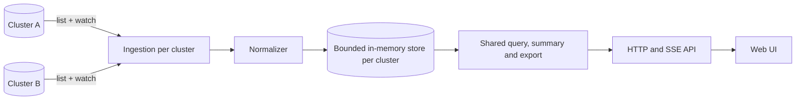

<div align="center">

# Kubernetes Events Explorer

[](#status)
[](#security-model)
[](LICENSE)
[](https://nodejs.org)
[](https://www.typescriptlang.org)

**Inspect, filter and follow Kubernetes `Event` records from live clusters, with counts and charts computed from the same query.**

</div>

---

Finding the few Warnings that matter for a workload inside routine `Scheduled`, `Pulling` and `Pulled` Events is hard in a flat list, and `kubectl get events` cannot combine reason, time range and object in one view. Explorer watches Events in one or more clusters through a read-only backend and serves filtered, paginated and summarized views to a web UI.

Explorer does not diagnose failures. An Event is best-effort supplemental information, and this tool does not claim that an Event explains why a workload failed.

## Contents

- [What it does](#what-it-does)
- [How it works](#how-it-works)
- [Deployment modes](#deployment-modes)
- [Quick start (local, kind)](#quick-start-local-kind)
- [Configuration](#configuration)
- [What you see: the observation window](#what-you-see-the-observation-window)
- [Filter rules](#filter-rules)
- [Security model](#security-model)
- [Testing](#testing)
- [Deploying in a cluster](#deploying-in-a-cluster)
- [Repository layout](#repository-layout)
- [Status](#status)
- [Documentation](#documentation)
- [Contributing](#contributing)
- [License](#license)

## What it does

- **Live Events** from one or more clusters, for both `events.k8s.io/v1` and core `v1` shapes, normalized into one record format.
- **Explorer:** keyword search, time range, namespace, type, reason, object kind and name, and reporter filters, with sorting, 50-row pages, removable filter chips and a clear-all action.
- **Detail panel:** normalized fields, timestamp source with fallback marking, occurrence-count status, validation issues and the untouched raw JSON.
- **Overview and Analytics:** counts, time buckets, reason and namespace breakdowns, computed on the server from the same query as the table.
- **Export:** CSV and JSON of the complete filtered result, across all pages, streamed from the server.
- **Live updates** while a view is open, over server-sent events.

Every record shows its cluster, its source and the time observation started. See [What you see](#what-you-see-the-observation-window).

## How it works



- The server reads Events with `get`, `list` and `watch` only. It never writes to the cluster.
- Each cluster has its own watch loop. It re-lists on `410 Gone`, reconnects with exponential backoff, and keeps running for other clusters if one fails.
- Records are held in memory and capped per cluster. When the cap is reached, the oldest records are evicted and the eviction is reported.
- The domain logic (normalization, timestamps, filters, sort, aggregation, export) is pure TypeScript in `packages/domain`. The server and the UI both use it, so the same rules govern every number on screen.

## Deployment modes

| Mode | Where it runs | How it connects | Login |
|---|---|---|---|
| **Local** | Your machine | Kubeconfig (`EVENTS_KUBECONFIG`, contexts in `EVENTS_CONTEXTS`) | None. Binds to `127.0.0.1`. |
| **In-cluster** | A pod in the cluster | ServiceAccount token and CA | Protected by the Ingress and OIDC (team mode) |
| **Team** | In-cluster or shared host | ServiceAccount token per cluster | OIDC. Access is limited to the clusters and namespaces granted to each user. |

The same container image and the same code serve all three modes.

## Quick start (local, kind)

**Requirements:** Node.js 24 LTS (see `.nvmrc`), pnpm, Docker, `kind`, and `kubectl`.

```bash
git clone https://github.com/<owner>/k8s-events-explorer.git
cd k8s-events-explorer
pnpm install --frozen-lockfile

# Create a kind cluster and generate some Events in a test namespace
scripts/kind/create.sh
pnpm exec tsx scripts/seed-events.ts --context kind-events-explorer

# Run the server (local mode) and the UI dev server
pnpm dev
```

Open `http://127.0.0.1:5173/`. The UI proxies `/api` to the server on `127.0.0.1:8080`.

To run the production build of the server with the UI bundled:

```bash
pnpm build
EVENTS_CONTEXTS=kind-events-explorer pnpm start
# open http://127.0.0.1:8080/
```

If the server cannot connect, `/readyz` returns 503 and the UI shows the cluster as `unreachable`.

## Configuration

| Variable | Default | Purpose |
|---|---|---|
| `EVENTS_MODE` | `local` | `local` or `in-cluster` |
| `EVENTS_KUBECONFIG` | `~/.kube/config` | Kubeconfig path (local mode) |
| `EVENTS_CONTEXTS` | current context | Comma-separated contexts to observe |
| `EVENTS_BIND_HOST` | `127.0.0.1` | Listen address. Non-loopback addresses require explicit configuration. |
| `EVENTS_PORT` | `8080` | HTTP port |
| `EVENTS_CACHE_MAX_PER_CLUSTER` | `100000` | Records kept per cluster before eviction |
| `EVENTS_AUTH_MODE` | `none` | `none` or `oidc` |
| `EVENTS_OIDC_ISSUER` | — | OIDC issuer URL (team mode) |
| `EVENTS_OIDC_CLIENT_ID` | — | OIDC client ID (team mode) |
| `EVENTS_OIDC_CLIENT_SECRET` | — | Read from a file or environment variable; never logged |
| `EVENTS_RBAC_FILE` | — | YAML file mapping roles to cluster and namespace grants (team mode) |
| `EVENTS_LOG_LEVEL` | `info` | Log level |

The server validates configuration at startup and refuses to start with an unsafe combination, for example authentication disabled on a non-loopback address.

## What you see: the observation window

Kubernetes keeps Events for about one hour by default. Explorer shows only the Events it has observed, since the time it started observing each cluster, so every data screen shows:

- The cluster name and source (`local` or `in-cluster`).
- The time observation started for that cluster.
- An eviction notice when records have been dropped from the cache.

The screen also carries this note:

> Kubernetes keeps Events for about one hour. This view shows only Events observed by this dashboard since the time above. It is not a complete history.

Relative time ranges (15 minutes, 1 hour, 6 hours, 24 hours) are measured against the server's clock, and the UI shows the server time used for each query. Custom ranges are entered in UTC.

## Filter rules

| Filter | Match rule |
|---|---|
| Namespace | Exact match against the Event's namespace. Multiple values use OR. |
| Type | `Normal` or `Warning`. Selecting both means no restriction. |
| Reason | Exact match. Multiple values use OR. |
| Object kind | Exact match against the referenced object's kind. |
| Object name | Case-insensitive substring. |
| Reporter | Exact match against the normalized reporter. |
| Time range | Last-observed time falls in the range (inclusive). Records with missing or invalid last-observed times are excluded from bounded ranges. |
| Keyword | Case-insensitive substring across reason, message, object name, namespace and reporter. |

Different categories combine with **AND**. Multiple values within one category combine with **OR**.

Example: `namespace = payments AND type = Warning AND (reason = BackOff OR reason = Failed) AND last observed within 1 hour`

Missing values display as `Not supplied` and invalid values as `Invalid value`. Nothing is replaced with the current time. First-observed and last-observed times are kept separate. A repeated Event series is one record with an occurrence count, not one row per occurrence.

## Security model

- **Read-only.** The server requires only `get`, `list` and `watch` on Events. The generated ServiceAccount Role grants nothing else.
- **No credentials in the browser.** Tokens, kubeconfig contents and certificate data stay on the server and never appear in responses, logs or exports.
- **TLS verification is always on.** There is no option to skip certificate checks.
- **Server-side authorization.** In team mode every endpoint, including export and the event stream, checks the caller's clusters and namespaces. Hiding a control in the UI is not a security boundary.
- **Sensitive content.** Event messages can contain image names and internal hostnames, so records are treated as sensitive and logs contain counts and IDs, not message text.
- **No browser storage** for application data. The only cookie is the team-mode login session.
- **No third-party runtime requests.** The UI loads only from its own origin.

See [`docs/SECURITY.md`](docs/SECURITY.md) for trust boundaries and the threat model.

## Testing

```bash
pnpm lint
pnpm typecheck
pnpm test              # unit tests for domain, server and web
pnpm test:coverage     # unit tests with coverage thresholds
pnpm test:integration  # server tests against a running kind cluster
pnpm test:e2e          # Playwright tests against a running server and kind cluster
pnpm bench             # server benchmark with 100,000 records
pnpm verify            # lint, typecheck, coverage, build and bundle budget
```

Tests create real Events in a kind cluster through the Kubernetes API. Expected values are computed from the cluster state at test time. The repository contains no JSON fixtures of Event data.

Benchmark results and the machine used are recorded in [`docs/OPERATIONS.md`](docs/OPERATIONS.md).

## Deploying in a cluster

```bash
helm install events-explorer deploy/helm/events-explorer \
  --namespace events-explorer --create-namespace \
  --set mode=in-cluster
```

The chart creates a ServiceAccount, a namespaced Role that grants `get`, `list` and `watch` on Events, and an Ingress. A ClusterRole for cluster-wide observation is available as an explicit option. See [`docs/OPERATIONS.md`](docs/OPERATIONS.md) for the full procedure, including team-mode OIDC setup with Keycloak.

Images are published to `ghcr.io/<owner>/k8s-events-explorer` for each version tag.

## Repository layout

```text
packages/domain   pure TypeScript: normalization, timestamps, filters, sort, aggregation, export
packages/server   Node.js backend: cluster connections, ingestion, store, query, API, auth
packages/web      React UI: explorer, overview, analytics, detail panel
deploy/           Helm chart, docker-compose for Keycloak (development)
scripts/          kind setup, Event seeding for tests, benchmark
docs/             specification, architecture, security, operations
```

## Status

The project is in active development. The current release line is `v0.2`.

| Phase | Scope | State |
|---|---|---|
| P0 | Foundations: remove prototype simulator, pnpm workspace, domain package | In progress |
| P1 | Local read path for one cluster | Planned |
| P2 | Export, summaries and live updates | Planned |
| P3 | In-cluster deployment and image | Planned |
| P4 | Multiple clusters and team mode (OIDC) | Planned |
| P5 | Hardening and release | Planned |

The earlier browser-only prototype, with simulated scenarios and fixtures, has been removed. Its history remains in version control.

## Documentation

- [`docs/PRD.md`](docs/PRD.md): product requirements and decisions
- [`docs/SPEC.md`](docs/SPEC.md): functional specification and acceptance tests
- [`docs/ARCHITECTURE.md`](docs/ARCHITECTURE.md): components, data flow and the ingestion model
- [`docs/SECURITY.md`](docs/SECURITY.md): trust boundaries, credentials and authorization
- [`docs/OPERATIONS.md`](docs/OPERATIONS.md): deployment, configuration, benchmarks and troubleshooting
- [`AGENTS.md`](AGENTS.md) and [`BUILD_SPEC.md`](BUILD_SPEC.md): rules for contributors and coding agents

## Contributing

1. Fork the repository and create a branch.
2. Link the change to a requirement or acceptance test in `docs/SPEC.md`, and add or update tests.
3. Run `pnpm install --frozen-lockfile` and `pnpm verify`.
4. Confirm the change does not add a runtime dependency, browser storage, third-party request or write operation to Kubernetes, unless the specification has been amended.
5. Open a pull request that describes the behavior change and the verification performed.

Kubernetes upstream discussion about `kubectl events` is a separate research track and is not part of this project's code.

## License

Licensed under the Apache License, Version 2.0. See [LICENSE](LICENSE).

<div align="center">
<sub>Read-only. Live data only. Every screen shows where its data came from.</sub>
</div>
